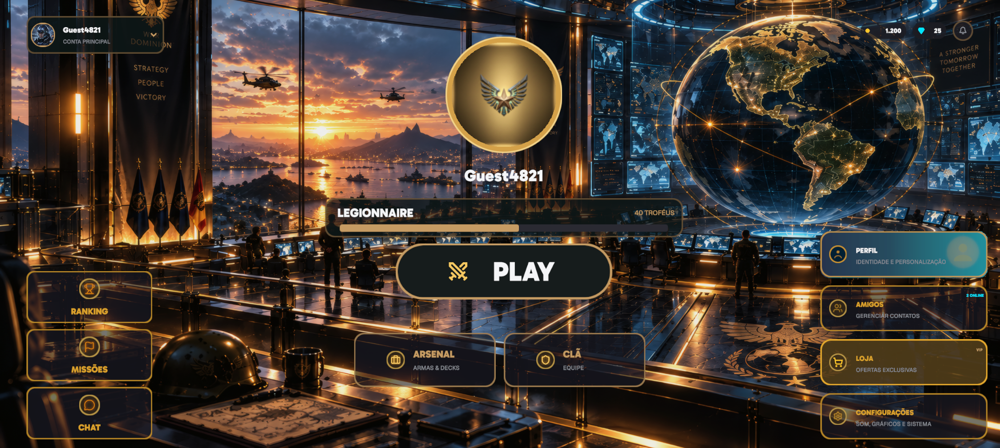
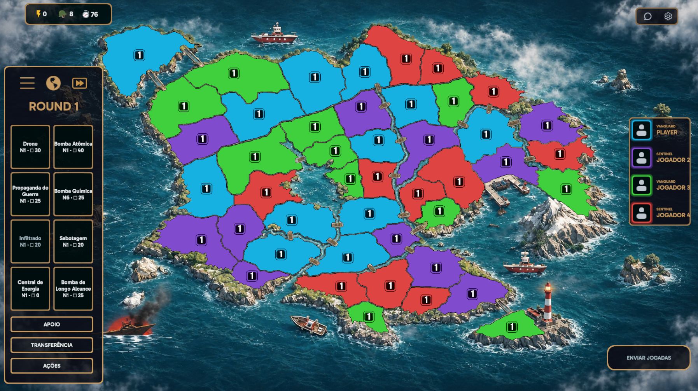
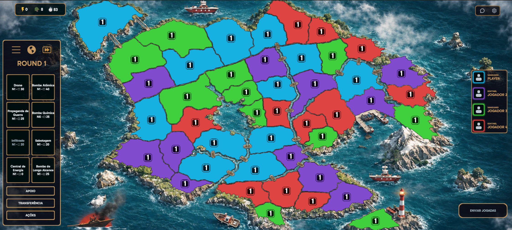
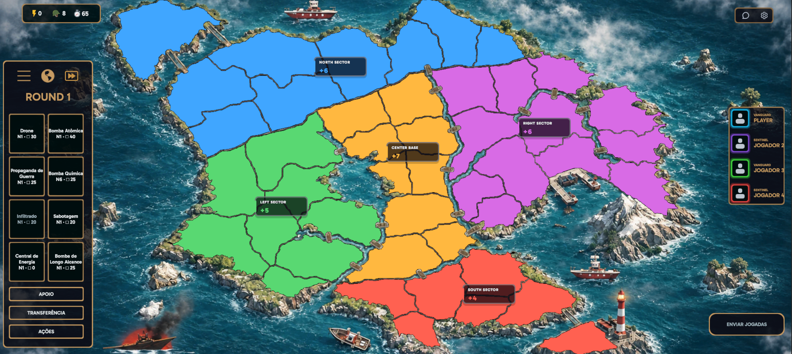
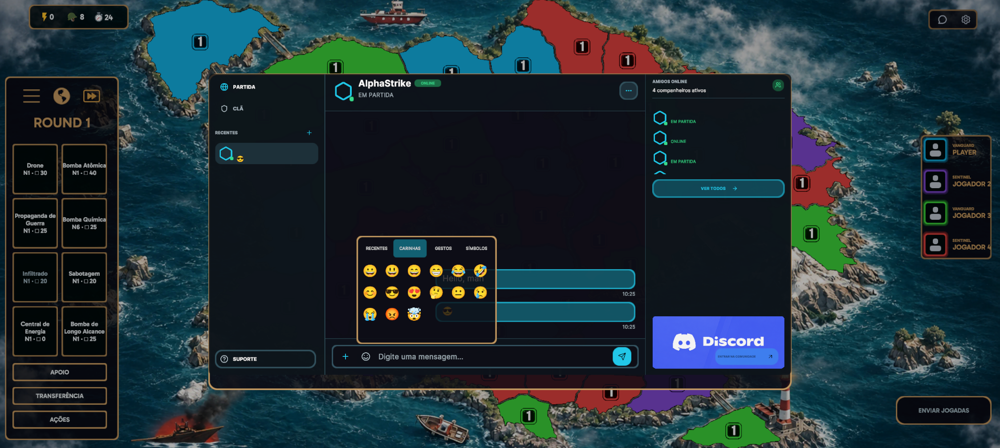
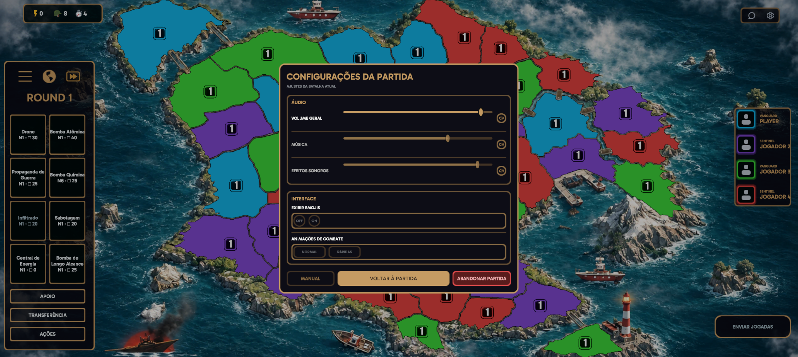

# WAR DOMINION

WAR DOMINION is a digital territory-based strategy game developed in Unity and C#. Players manage troops, plan territorial movements, and use weapons and actions through a round-based flow with Preparation and Resolution phases.

## Project Status

WAR DOMINION is currently under active development.

The current project includes playable match systems, interactive maps, and an interface oriented toward desktop and landscape mobile use. Chat and social presentation use local repositories; they do not represent an operational public online multiplayer service.

## Match Presentation

The match interface accommodates different landscape aspect ratios while keeping the map as the main interaction area. The examples below show the base 16:9 composition and its adaptation to a wider 20:9 format.

> **Development note:** The in-match interface is currently being progressively rebuilt. Some elements visible in these screenshots—particularly the player panel on the right and the weapon/action area on the left—are still structural foundations and do not represent their final visual design. Other components have already reached their approved visual stage.

### 16:9 — Base Composition

### 20:9 — Wider Landscape Composition

## Current Systems

- Interactive maps with territory ownership states and troop counters.
- Round-based Preparation and Resolution phases, troop management, and territorial movement.
- Weapon and action execution systems.
- Multiple match configurations represented in the project.
- Regions, regional bonuses, and a contextual player information overlay.
- In-match chat with message history, drafts, Unicode text, and colored emoji presentation.
- Contextual match settings and match exit confirmation.
- Responsive match presentation for the demonstrated landscape formats.
- Android development build workflow and automated Unity EditMode tests.

## Feature Screenshots

### Regions

Contextual visualization of regions and their associated bonuses.

### In-Match Chat

Chat integrated into the match interface, with a colored emoji picker and Unicode message presentation.

### Match Settings

A contextual settings panel within the match. The screenshot shows the current interface; not every visible control is fully connected to its underlying functionality.

## Technology

- Unity and C#.
- Unity UI (uGUI) and TextMeshPro.
- Unity Test Framework with EditMode tests.
- Android development builds through Unity Build Profiles.
- Git and GitHub.

## Architecture

The project separates gameplay state, match flow, UI presentation, weapon/action execution, and map definitions. Presentation components consume shared state and commands, while automated tests cover domain behavior and UI integration.

## Author

**Rodrigo Pavão**

Software Development · Game Development · Analysis and Systems Development.
